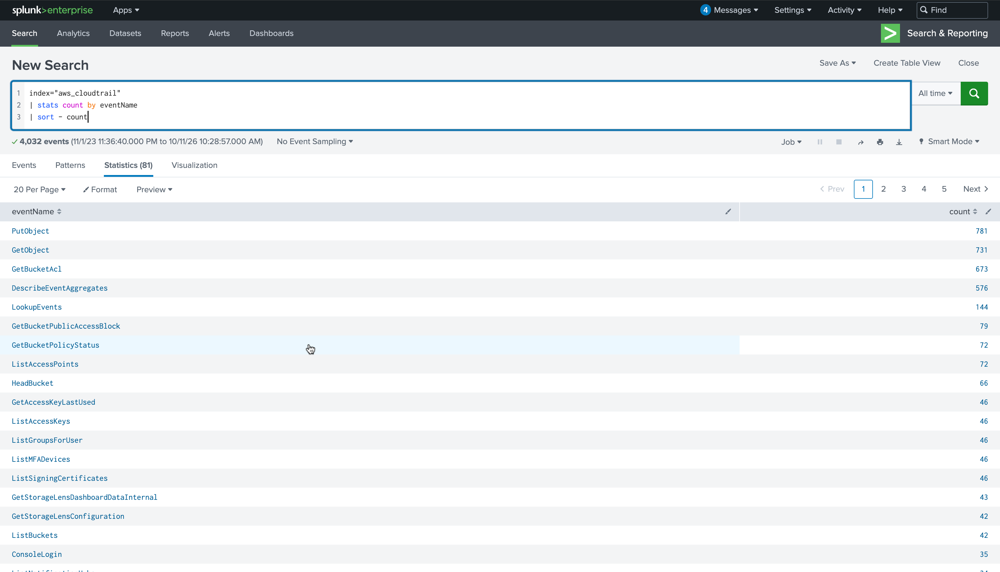
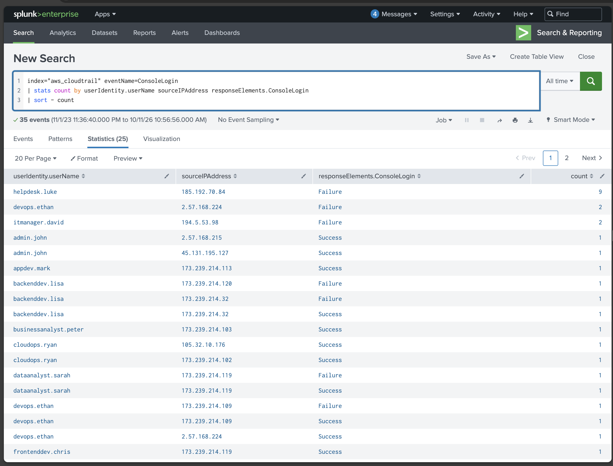
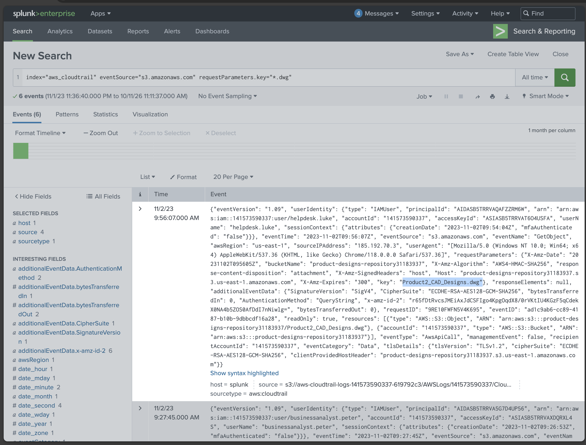
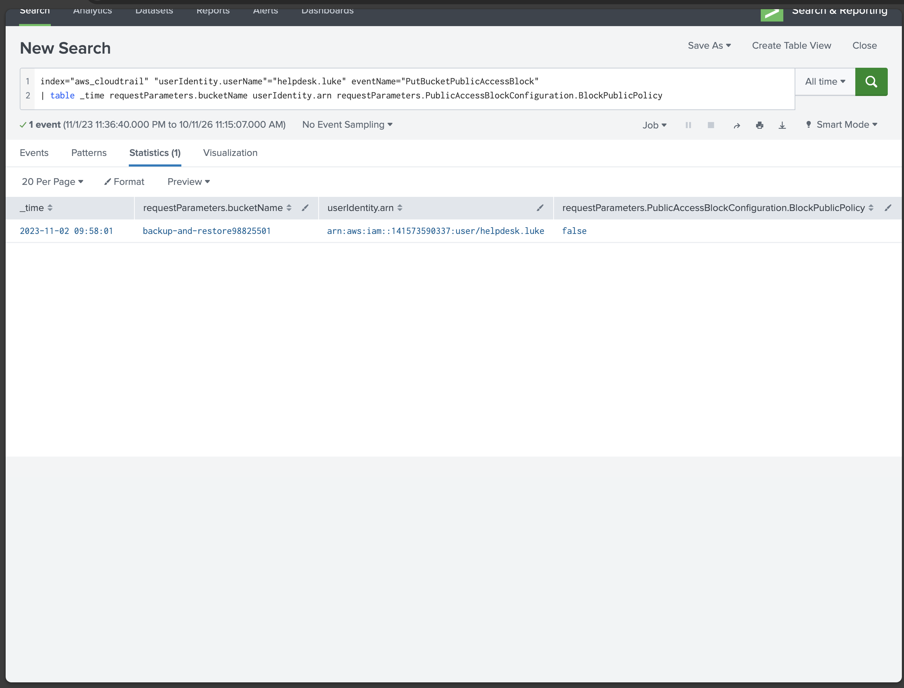
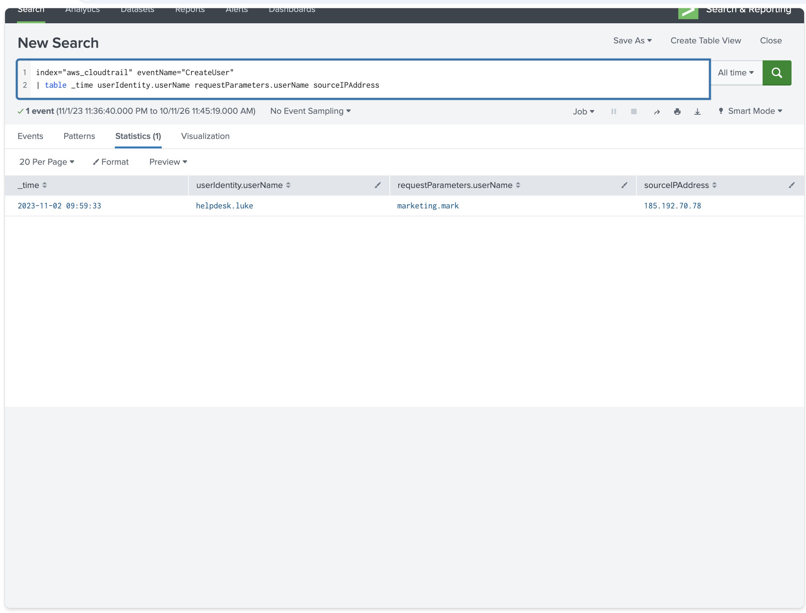
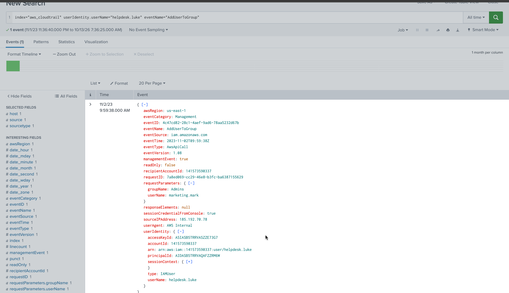

# AWSRaid — AWS CloudTrail Incident Hunt

| | |
|---|---|
| **Platform** | CyberDefenders |
| **Category** | Cloud Forensics |
| **Tools** | Splunk, AWS CloudTrail |
| **ATT&CK** | T1110 (Brute Force), T1530 (Data from Cloud Storage), T1562.001 (Impair Defenses), T1136.003 (Create Account: Cloud), T1098 (Account Manipulation) |

## Overview

An AWS environment (account `141573590337`, region `us-east-1`) was compromised, and CloudTrail logs ingested into Splunk are the available evidence. CloudTrail records one entry per AWS API call, so every attacker action leaves a corresponding event. The objective is to reconstruct the intrusion in sequence: initial access, S3 data access, public exposure of a bucket, and the persistence and privilege escalation established afterward. The entire attack was carried out from the `185.192.70.0/24` range and completed in roughly three minutes (09:56 to 09:59 UTC on 2 November 2023).

## Reading CloudTrail in Splunk

Each CloudTrail record represents one AWS API call. The fields that carry the investigation are:

| Field | Purpose |
|---|---|
| `eventSource` | the AWS service (`signin.amazonaws.com`, `s3.amazonaws.com`, `iam.amazonaws.com`) |
| `eventName` | the specific API action (`ConsoleLogin`, `GetObject`, `CreateUser`) |
| `userIdentity.userName` / `.arn` | the identity making the call |
| `sourceIPAddress` | the origin of the call |
| `responseElements.ConsoleLogin` | `Success` or `Failure` for sign-in attempts |
| `requestParameters.*` | the target (bucket, object key, user, group) |

The dataset holds 4,032 events across 81 distinct `eventName` values, most of it legitimate background traffic. The time range is set to **All time** before searching, because the data is historical. An overview query establishes the vocabulary of activity before filtering for the attack:

```spl
index="aws_cloudtrail" | stats count by eventName | sort -count
```



## Methodology

### 1. Establish initial access

Sign-in events originate from `signin.amazonaws.com`. Grouping `ConsoleLogin` by user, source IP, and result surfaces one account with a burst of failures that no other account shows:

```spl
index="aws_cloudtrail" eventName=ConsoleLogin
| stats count by userIdentity.userName, sourceIPAddress, responseElements.ConsoleLogin
| sort -count
```

`helpdesk.luke` has **9 failed logins from `185.192.70.84`**, far above the one or two failures seen for normal users, which is the signature of a brute-force attempt (T1110). The subsequent success from the same `185.192.70.0/24` range confirms the account was taken over. `helpdesk.luke` is the compromised account and the pivot for the rest of the investigation.



### 2. Identify S3 data access

Pivoting on the compromised identity and filtering S3 reads shows the attacker targeting CAD design files. Filtering object keys for the `.dwg` extension isolates the accessed designs:

```spl
index="aws_cloudtrail" eventSource="s3.amazonaws.com" requestParameters.key="*.dwg"
```

`helpdesk.luke` performed `GetObject` on `Product2_CAD_Designs.dwg` in bucket `product-designs-repository31183937` at 09:56:07 from `185.192.70.3`. This is the data-theft stage (T1530): proprietary design files read directly from S3.



### 3. Identify public exposure

`PutBucketPublicAccessBlock` indicates a bucket's public-access protection being changed. Tabling the request parameters shows what was weakened:

```spl
index="aws_cloudtrail" "userIdentity.userName"="helpdesk.luke" eventName="PutBucketPublicAccessBlock"
| table _time, requestParameters.bucketName, userIdentity.arn, requestParameters.PublicAccessBlockConfiguration.BlockPublicPolicy
```

At 09:58:01, `helpdesk.luke` set `BlockPublicPolicy` to **false** on bucket `backup-and-restore98825501`, disabling the guardrail that keeps the bucket private and exposing it to public access (T1562.001).



### 4. Identify persistence

`CreateUser` indicates a new IAM identity created as a backdoor, preserving access independent of the compromised account:

```spl
index="aws_cloudtrail" eventName="CreateUser"
| table _time, userIdentity.userName, requestParameters.userName, sourceIPAddress
```

At 09:59:33, `helpdesk.luke` created the IAM user `marketing.mark` from `185.192.70.78` (T1136.003). The deceptive name blends in with normal staff accounts.



### 5. Identify privilege escalation

A new IAM user has no permissions by default. `AddUserToGroup` attaches it to a privileged group to inherit elevated permissions:

```spl
index="aws_cloudtrail" userIdentity.userName="helpdesk.luke" eventName="AddUserToGroup"
```

At 09:59:38 (five seconds after creating the account), `helpdesk.luke` added `marketing.mark` to the **Admins** group (T1098). The `requestParameters` confirm `groupName: Admins`, `userName: marketing.mark`, granting the backdoor account administrative rights.



## Key findings

| Stage | Finding | Source |
|---|---|---|
| Initial access | `helpdesk.luke` compromised via brute force; 9 failed logins from `185.192.70.84` | ConsoleLogin |
| Attacker range | `185.192.70.0/24` (`.84` brute force, `.3` S3 read, `.78` IAM actions) | sourceIPAddress |
| Collection | `GetObject` on `Product2_CAD_Designs.dwg`, bucket `product-designs-repository31183937` | GetObject |
| Exposure | `backup-and-restore98825501` made public (`BlockPublicPolicy=false`) | PutBucketPublicAccessBlock |
| Persistence | backdoor IAM user `marketing.mark` created | CreateUser |
| Privilege escalation | `marketing.mark` added to the `Admins` group | AddUserToGroup |

## MITRE ATT&CK mapping

| Tactic | Technique | ID | Evidence |
|---|---|---|---|
| Credential Access | Brute Force | T1110 | 9 failed `ConsoleLogin` for helpdesk.luke from 185.192.70.84, then success |
| Collection | Data from Cloud Storage | T1530 | `GetObject` on `Product2_CAD_Designs.dwg` |
| Defense Evasion | Impair Defenses: Disable or Modify Tools | T1562.001 | `PutBucketPublicAccessBlock` set `BlockPublicPolicy=false` |
| Persistence | Create Account: Cloud Account | T1136.003 | `CreateUser` of `marketing.mark` |
| Privilege Escalation | Account Manipulation | T1098 | `AddUserToGroup` adding `marketing.mark` to `Admins` |

## Analysis notes and detection

- CloudTrail is a complete audit log of API calls; in a noisy environment (4,032 events, 81 action types) the attack is isolated not by event volume but by pivoting on the compromised identity, which collapses the data to one actor's ~480 events.
- The brute-force signature was quantitative: one account with 9 failed logins stood out sharply against the one-or-two failures normal for legitimate users.
- The full chain executed in about three minutes, and the five-second gap between `CreateUser` and `AddUserToGroup` shows the persistence and escalation were scripted or pre-planned.
- `helpdesk.luke` acting on IAM and S3 is itself anomalous: a helpdesk identity has no business reading CAD files, disabling public-access blocks, or creating admin users.
- **Detection:** alert on a burst of failed `ConsoleLogin` followed by success from one IP or range; on `PutBucketPublicAccessBlock` setting `BlockPublicPolicy=false`; and on `CreateUser` followed closely by `AddUserToGroup` into a privileged group, especially from a non-administrative identity.

<!-- Retired lab. Account IDs, usernames and IPs are lab artifacts, not real PII. -->
