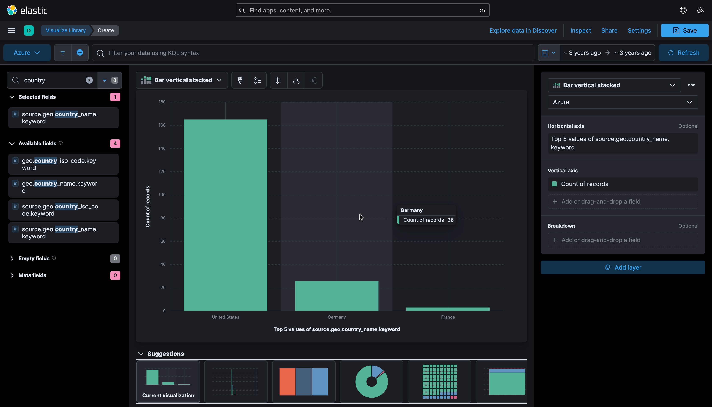
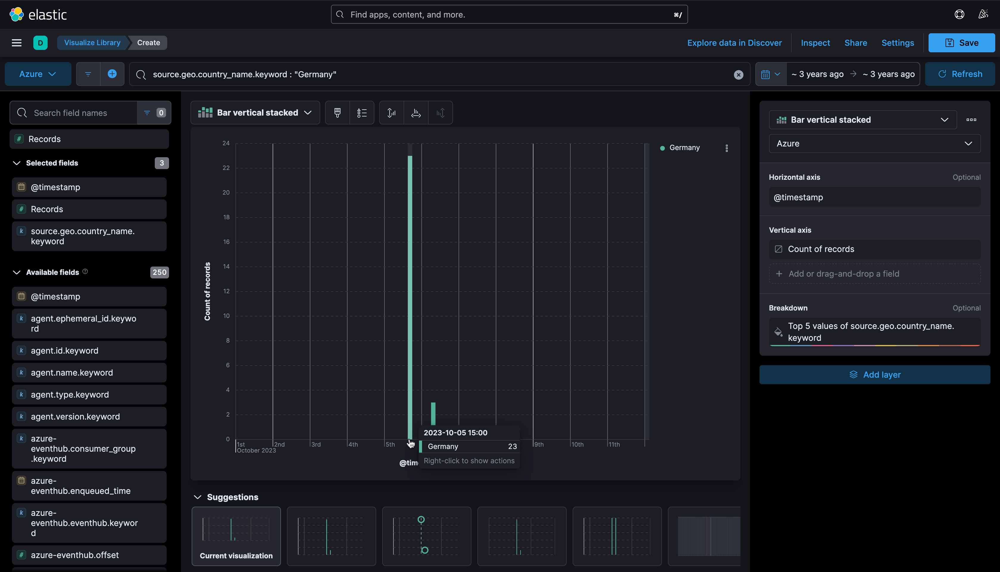
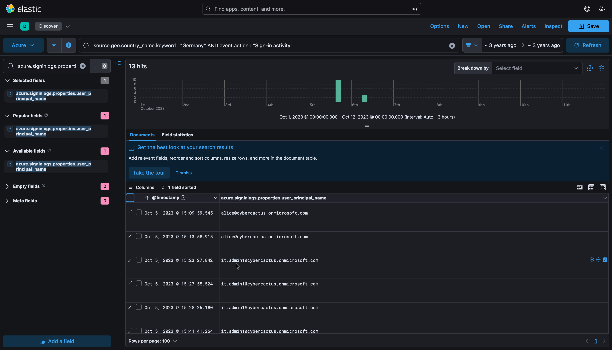
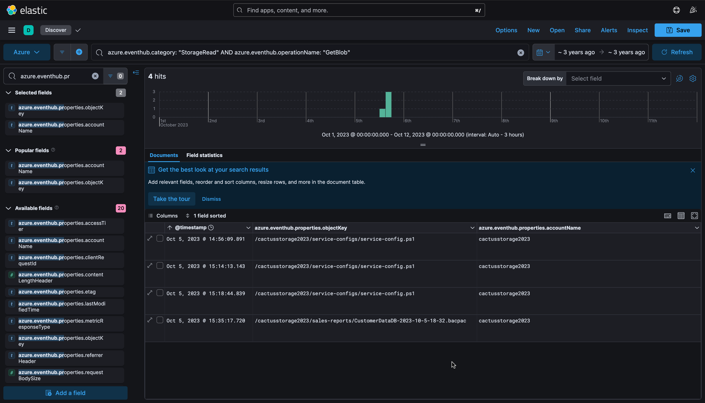
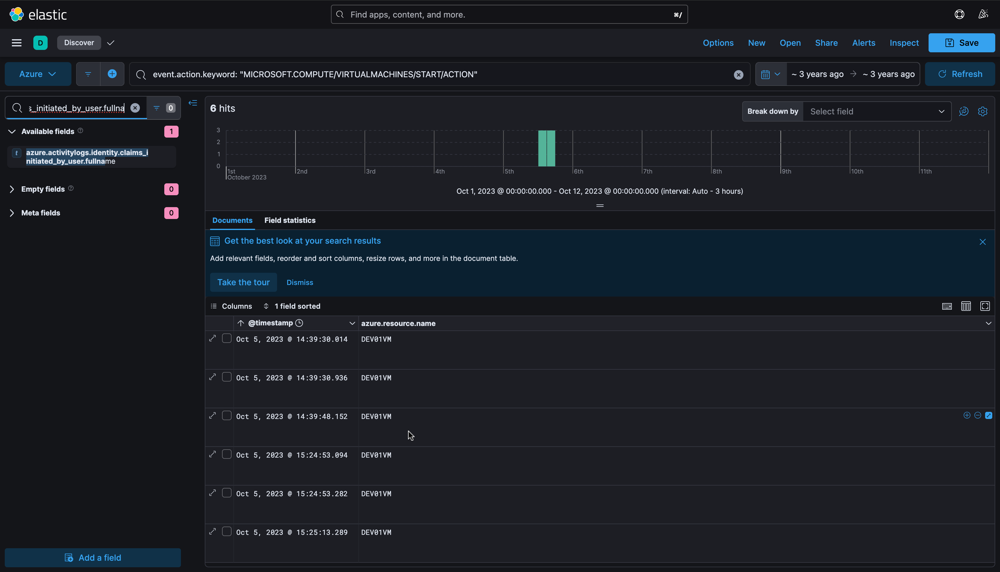
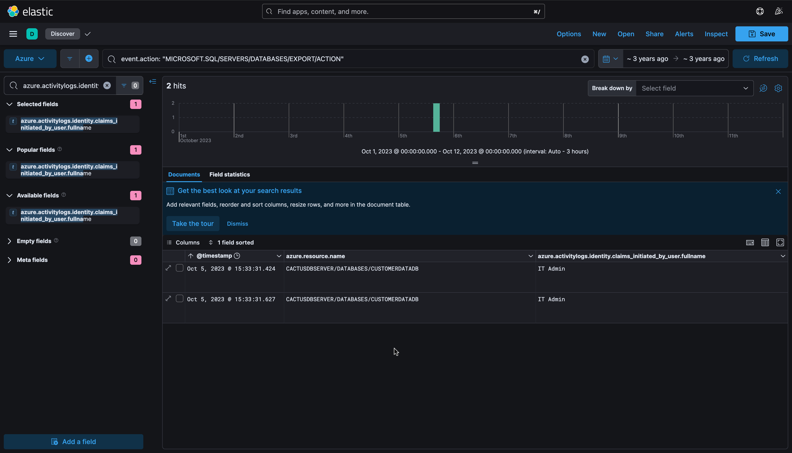
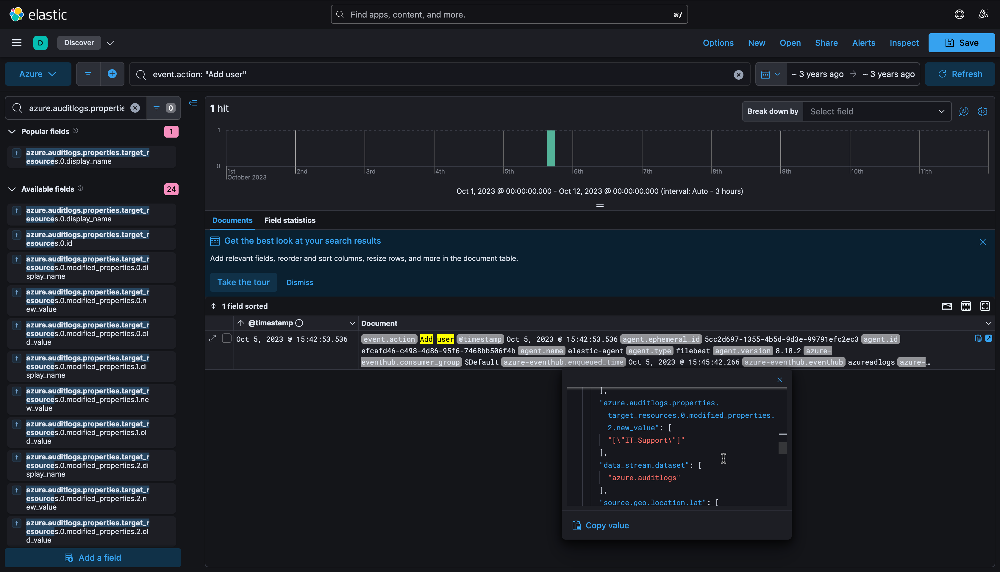
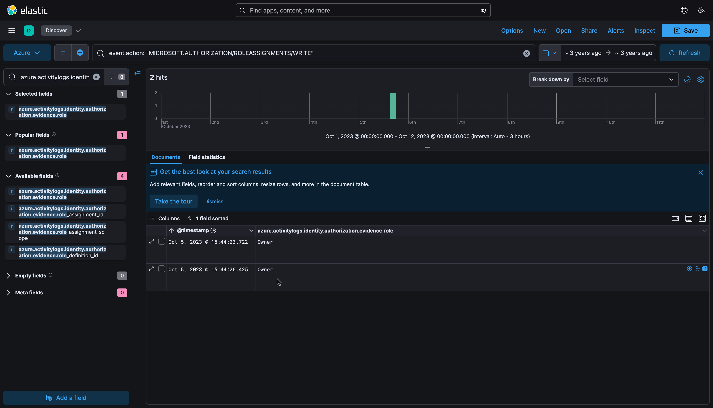
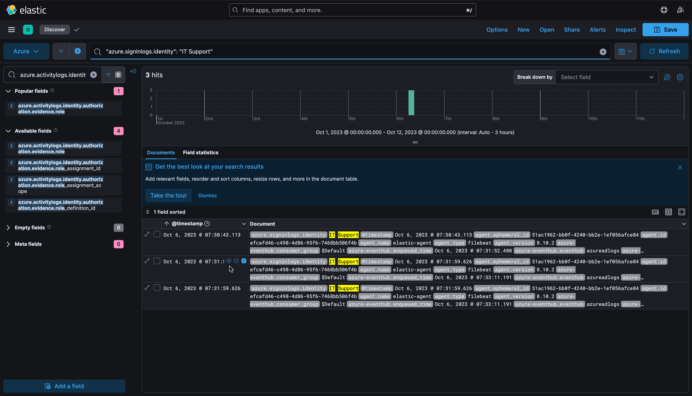

# AzureHunt — Azure AD / Activity / Blob Storage Hunt

| | |
|---|---|
| **Platform** | CyberDefenders |
| **Category** | Cloud Forensics |
| **Tools** | Elastic Stack (ELK / Kibana) |
| **ATT&CK** | T1078.004, T1530, T1537, T1578, T1136.003, T1098.003 |

## Overview

A US-based Azure tenant (`cybercactus.onmicrosoft.com`) saw a surge of suspicious activity from an unexpected country. Three Azure log sources are forwarded into Elastic: **Azure AD** sign-in and audit logs, **Azure Activity** logs, and **Blob Storage** logs. Azure has no single CloudTrail equivalent, so the investigation correlates the three streams in Kibana to rebuild the full attack timeline: initial access, data collection, lateral movement, impact, persistence, and privilege escalation. The entire intrusion ran on 5 October 2023 (15:09 to 15:44 UTC), with the attacker returning the next morning.

## Reading Azure logs in Elastic (Kibana)

The three streams answer different questions, and each uses its own field namespace:

| Log source | Answers | Key fields |
|---|---|---|
| Azure AD sign-in | who signed in, from where, success/failure | `azure.signinlogs.properties.user_display_name`, `.user_principal_name`, `source.address`, `event.outcome` |
| Azure AD audit | directory changes: user creation, role adds | `azure.auditlogs.properties.target_resources.*`, `client.ip` |
| Azure Activity | control-plane actions on resources | `azure.activitylogs.identity.claims_initiated_by_user.fullname`, `azure.resource.name` |
| Blob Storage | object-level reads (exfiltration) | `azure.eventhub.properties.accountName`, `.objectKey`, `azure.eventhub.callerIpAddress` |

Investigation is done in Kibana Discover with KQL, using the field sidebar to facet values rather than aggregate counts.

## Methodology

### 1. Scope the anomaly by geography

For a US-based company, legitimate traffic originates largely from the US. A Terms aggregation on `source.geo.country_name.keyword` (Lens bar chart) surfaces a sharp spike from **Germany**, the attacker's origin, against the US baseline.



Filtering to Germany and breaking the activity down over time pins the start of the incident to **5 Oct 2023, ~15:00**:

```
source.geo.country_name.keyword : "Germany"
```



### 2. Identify initial access and lateral movement (sign-in logs)

Filtering sign-ins from Germany and reading the principal names isolates the compromised accounts in order. The first successful sign-in belongs to **alice** (`alice@cybercactus.onmicrosoft.com`) from `85.203.15.6`. At `15:23:27` the account flips to **it.admin1** (`it.admin1@cybercactus.onmicrosoft.com`) from a different IP, `84.247.59.224`, same German origin: the attacker pivoted from the low-privilege user to a privileged admin account (T1078.004).

```
source.geo.country_name.keyword : "Germany" AND event.action : "Sign-in activity"
```



### 3. Identify data collection in Blob Storage

Blob reads are recorded under the `StorageRead` category. Filtering for `GetBlob` shows the attacker reading a PowerShell script, **`service-config.ps1`**, from `/cactusstorage2023/service-configs/` in storage account **`cactusstorage2023`** (T1530). A `.ps1` config script is a likely source of credentials or environment detail. The same storage account later receives the exported database `.bacpac`, tying the streams together.

```
azure.eventhub.category: "StorageRead" AND azure.eventhub.operationName: "GetBlob"
```



### 4. Assess impact (Activity logs)

With admin access, the attacker acted on resources. Two Activity-log queries show the impact.

VM start: the admin account started VM **`DEV01VM`** (T1578).

```
event.action.keyword: "MICROSOFT.COMPUTE/VIRTUALMACHINES/START/ACTION"
```



Database export: at `15:33:31`, the IT Admin account exported database **`CUSTOMERDATADB`** on server `CACTUSDBSERVER` (T1537, data exposure).

```
event.action: "MICROSOFT.SQL/SERVERS/DATABASES/EXPORT/ACTION"
```



### 5. Uncover persistence (audit logs)

Filtering audit logs for user creation returns a single event at `15:42:53`. The created account's name is not in the `display_name` column (it reads `-`); expanding the raw document shows it under `target_resources.0.modified_properties.2.new_value` as **`IT_Support`** (T1136.003). This is the "find the real field" step: the value exists, just under a different nested key than expected.

```
event.action: "Add user"
```



### 6. Identify privilege escalation (Activity logs)

Role assignments are control-plane events. At `15:44`, the compromised IT Admin account assigned the **Owner** role (`azure.activitylogs.identity.authorization.evidence.role`), granting the backdoor full administrative control over the subscription (T1098.003).

```
event.action: "MICROSOFT.AUTHORIZATION/ROLEASSIGNMENTS/WRITE"
```



### 7. Confirm the persistent foothold

Searching for activity on the backdoor account shows its first successful login on **6 Oct 2023, 07:30:43**, the next morning, confirming the attacker returned to use the persistence account.

```
"azure.signinlogs.identity": "IT Support"
```



## Key findings

| Q | Finding |
|---|---|
| Q1 Origin country | **Germany** |
| Q2 First activity timestamp | **5 Oct 2023, 15:09** |
| Q3 Compromised account | **alice** (`alice@cybercactus.onmicrosoft.com`) |
| Q4 Blob script accessed | **service-config.ps1** |
| Q5 Storage account | **cactusstorage2023** |
| Q6 Second compromised UPN | **it.admin1@cybercactus.onmicrosoft.com** (IT Admin) |
| Q7 VM started | **DEV01VM** |
| Q8 Database exported | **CUSTOMERDATADB** |
| Q9 Persistence account | **IT Support** (`IT_Support@cybercactus.onmicrosoft.com`) |
| Q10 Role granted | **Owner** |
| Q11 First IT Support login | **6 Oct 2023, 07:30:43** |

**Attacker infrastructure:** Germany, `85.203.15.0/24` range plus `84.247.59.224`.

## MITRE ATT&CK mapping

| Tactic | Technique | ID | Evidence |
|---|---|---|---|
| Initial Access | Valid Accounts: Cloud Accounts | T1078.004 | alice sign-in from Germany |
| Collection | Data from Cloud Storage | T1530 | `GetBlob` on `service-config.ps1` |
| Lateral Movement | Valid Accounts: Cloud Accounts | T1078.004 | pivot to IT Admin (`it.admin1`) |
| Impact | Modify Cloud Compute Infrastructure | T1578 | started VM `DEV01VM` |
| Exfiltration | Transfer Data to Cloud Account | T1537 | exported DB `CUSTOMERDATADB` |
| Persistence | Create Account: Cloud Account | T1136.003 | added user `IT Support` |
| Privilege Escalation | Account Manipulation: Additional Cloud Roles | T1098.003 | assigned `Owner` role |

## Analysis notes and detection

- Azure forensics is a correlation exercise across sign-in, audit, activity, and storage logs, joined on actor, IP, and time window. No single log tells the whole story.
- The attack is textbook and fast (~35 minutes): one geographic anomaly unravels into account compromise, data theft, lateral movement to admin, resource abuse, and a hard-coded persistence account with Owner rights.
- Each log stream uses a different field namespace (`azure.signinlogs.*`, `azure.auditlogs.*`, `azure.activitylogs.*`, `azure.eventhub.*`); knowing which namespace holds which answer is the core Kibana skill, and some values (the created username) live only in a nested `modified_properties` field, found by expanding the raw document.
- **Detection:** alert on successful sign-ins from atypical geographies for a US tenant; on `Add user` and `ROLEASSIGNMENTS/WRITE` granting Owner; on database `EXPORT` actions; and on Blob `GetBlob` of config/script files from unfamiliar IPs.

<!-- Retired lab. Account names, IPs and resources are lab artifacts, not real PII. -->
